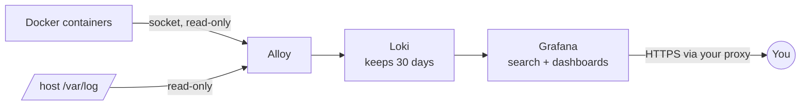

<div align="center">

# 📜 Centralized Logs

**Every log on your VPS — Docker containers and the host system — in a single search box, with ready-made security dashboards. Uses ~260 MB of RAM.**

[](LICENSE)
[](docker-compose.yml)
[](https://grafana.com/oss/loki/)
[](https://keizactech.com/docs)

</div>

---

## ✨ What it does

- Collects the logs of **all your containers** and the **host** (`auth.log`, `fail2ban`, `ufw`, `syslog`).
- Lets you search them from **Grafana** with filters like `{container="my-api"} |= "error"`.
- Ships **2 ready-made dashboards** (panel titles are in Spanish):
  - **Server security**: failed SSH passwords, made-up usernames, remote-desktop probes, successful logins and fail2ban bans.
  - **Containers**: errors per container and log volume.

## 🧠 How it works



| Piece | What it does | Measured RAM |
|---|---|---|
| **Alloy** | Collects the logs. Mounts `/var/log` and the Docker socket **read-only** | ~65 MB |
| **Loki** | Stores them. Indexes only the labels, not every word | ~87 MB |
| **Grafana** | Search and dashboards. The only thing exposed to the proxy | ~108 MB |

### The golden rule
**The watcher can't depend on what it watches.** It runs in its own `docker compose`: if your site or your API goes down, the log viewer stays up so you can see why.

## 🚀 Quick start

```bash
git clone https://github.com/RosaritoRD/logs-centralizados.git
cd logs-centralizados
cp .env.example .env          # set your proxy's network name
# Create .env.grafana with your Grafana user and password (see below)
docker compose up -d
docker compose logs -f alloy  # check it's collecting without errors
```

`.env.grafana` (permissions `600`, **never commit it**):
```
GF_SECURITY_ADMIN_USER=YOUR_USERNAME_HERE
GF_SECURITY_ADMIN_PASSWORD=A_LONG_PASSWORD_HERE
```

⚠️ Grafana only applies that user and password **the first time it starts**, with an empty database. To change them later, delete its volume and start again. You lose nothing, because the dashboards and the data source come from files.

### Useful queries (Grafana → Explore)

```
{source="host", job="ssh"}   |= "Failed password"   # SSH login attempts
{container="my-api"}         |= "error"              # errors from one container
{container=~"n8n.*"}                                 # several containers at once
```

## 🔒 Security
- Alloy mounts everything **read-only**: it can't touch your containers or your files.
- Every service has a `mem_limit`. A heavy query won't eat your apps' RAM.
- Dashboards are edited in JSON, not from the UI (`allowUiUpdates: false`). What you see is what's in git.

## 🤖 With Claude Code or Codex
Open the folder with `claude` or `codex` and ask, for example: *"Add a panel with nginx 5xx errors"* or *"Make Alloy also collect /var/log/nginx"*.

## 💸 Savings and tips
See **[SAVINGS-AND-TIPS.md](SAVINGS-AND-TIPS.md)**.

## 🤝 Contributing
Issues and PRs are welcome — look for the [`good first issue`](https://github.com/RosaritoRD/logs-centralizados/labels/good%20first%20issue) label and read [CONTRIBUTING.md](CONTRIBUTING.md).

## 📚 More
📖 Guides and more projects: **[keizactech.com/docs](https://keizactech.com/docs)**

## 📄 License
MIT — see [LICENSE](LICENSE).
