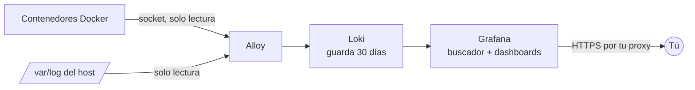

<div align="center">

# 📜 Logs centralizados

**Todos los logs de tu VPS —contenedores Docker y sistema— en un solo buscador, con dashboards de seguridad listos. Ocupa ~260 MB de RAM.**

[](docker-compose.yml)
[](https://grafana.com/oss/loki/)
[](https://keizactech.com/docs)

</div>

---

## ✨ Qué hace

- Junta los logs de **todos tus contenedores** y del **host** (`auth.log`, `fail2ban`, `ufw`, `syslog`).
- Los puedes buscar desde **Grafana** con filtros como `{container="mi-api"} |= "error"`.
- Trae **2 dashboards** listos:
  - **Seguridad del servidor**: contraseñas SSH falladas, usuarios inventados, sondas al escritorio remoto, accesos correctos y bloqueos de fail2ban.
  - **Contenedores**: errores por contenedor y volumen de líneas.

## 🧠 Cómo funciona



| Pieza | Qué hace | RAM medida |
|---|---|---|
| **Alloy** | Recoge los logs. Monta `/var/log` y el socket de Docker en **solo lectura** | ~65 MB |
| **Loki** | Los guarda. Indexa solo las etiquetas, no cada palabra | ~87 MB |
| **Grafana** | Buscador y dashboards. Es lo único expuesto al proxy | ~108 MB |

### La regla de oro
**Lo que vigila no puede depender de lo vigilado.** Va en su propio `docker compose`: si tu web o tu API se caen, el visor sigue en pie para que puedas ver por qué.

## 🚀 Arranque rápido

```bash
git clone https://github.com/RosaritoRD/logs-centralizados.git
cd logs-centralizados
cp .env.example .env          # pon el nombre de la red de tu proxy
# Crea .env.grafana con tu usuario y contraseña de Grafana (ver abajo)
docker compose up -d
docker compose logs -f alloy  # comprobar que recoge sin errores
```

`.env.grafana` (permisos `600`, **nunca a git**):
```
GF_SECURITY_ADMIN_USER=AQUI_VA_TU_USUARIO
GF_SECURITY_ADMIN_PASSWORD=AQUI_VA_UNA_CONTRASEÑA_LARGA
```

⚠️ Grafana solo aplica ese usuario y esa contraseña **la primera vez que arranca**, con la base de datos vacía. Para cambiarlos después hay que borrar su volumen y volver a arrancar. No se pierde nada, porque los dashboards y la fuente de datos vienen de archivos.

### Consultas útiles (Grafana → Explore)

```
{origen="host", job="ssh"}   |= "Failed password"   # intentos de entrar por SSH
{container="mi-api"}         |= "error"              # errores de un contenedor
{container=~"n8n.*"}                                 # varios contenedores a la vez
```

## 🔒 Seguridad
- Alloy lo monta todo en **solo lectura**: no puede tocar tus contenedores ni tus archivos.
- Cada servicio tiene `mem_limit`. Una consulta pesada no se lleva la RAM de tus apps.
- Los dashboards se editan en el JSON, no desde la interfaz (`allowUiUpdates: false`). Así lo que ves es lo que está en git.

## 🤖 Con Claude Code o Codex
Abre la carpeta con `claude` o `codex` y pídele, por ejemplo: *"Añade un panel con los errores 5xx de nginx"* o *"Haz que Alloy recoja también /var/log/nginx"*.

## 💸 Ahorro y mejoras
Ver **[AHORRO-Y-MEJORAS.md](AHORRO-Y-MEJORAS.md)**.

## 📚 Más
📖 Guías y más proyectos: **[keizactech.com/docs](https://keizactech.com/docs)**

## 📄 Licencia
MIT — ver [LICENSE](LICENSE).
